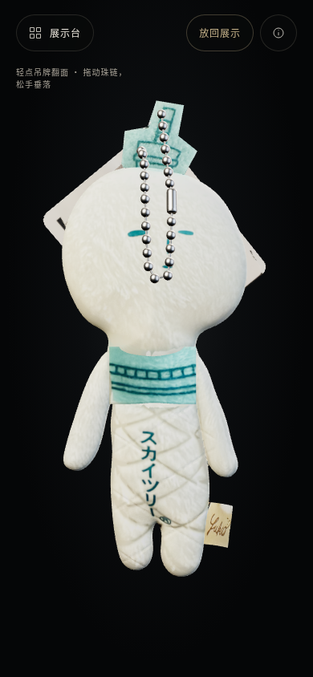

# 珍藏 · 私人藏品

毛绒挂件与晴空塔冰箱贴的悬浮交互展览。下载本分支后，打开 [离线完整展览](dist/keepsake.html) 即可使用，模型、贴图和程序已全部内嵌。

## 本次更新

展示由玩偶本体受到支撑，珠链没有不可见的顶端固定点。全部链珠自由运动，重力在旋转视图时仍保持世界向下，并响应拖动和松手。链珠之间及与物体之间有碰撞和长度约束，停止后休眠，不会持续循环摇摆。轻点纸质吊牌可独立翻到另一面；拖动吊牌或珠链后松手，会自然回落。两面均保留原照片贴图。

单指拖动物件仍可旋转查看，双指缩放与转动。松手惯性按秒计算，在 30、60、120 帧下保持一致；多指接续、取消、失焦与切换物品会正确释放抓取。玩偶长按轻触的压痕上限仍为 0.45 mm，照片还原的薄头、细腿、布饰与布标保留。

冰箱贴背面改为独立的照片透视配准，修复旧镜像 UV 在边缘采到背景的问题；照片轮廓误连的塔身／星形、星形／云朵凹口也已恢复。原背面照片、表面细节和文字保留，没有替换为纯色。缺少必要图片时明确报告加载失败。包装纸卡背面另按真实纸边与圆孔校正：排除照片顶部布料背景，拉平弯曲的印刷行，保留原始条码、标志和文字。原有五步拆包与四面纸卡保持完整。

自动翻牌会先绕开玩偶头部，再降到自然悬挂的位置并撤去辅助力。取景按真实圆角轮廓与透视深度计算，保留初始模型大小，向外及时留足空间，恢复时平滑收回。320/390/430 像素竖屏各连续四次翻牌全过程完整可见，实际玩偶高度最低保留 85.6%；直接抓取时不自动移动取景。

手机显示像素比例最高为 2，桌面最高为 3。减少动态效果设置会关闭视图旋转惯性和附加扰动。

[包装背卡修复前](preview/card-back-before.png) · [修复后](preview/card-back-after.png) · [斜视](preview/card-back-oblique.png) · [最终原生操作正视](preview/card-back-native.png) · [原生斜视](preview/card-back-native-oblique.png)

[自然下垂](preview/plush-gravity-rest.png) · [翻面后](preview/plush-tag-turned.png) · [另一面](preview/plush-tag-back.png) · [磁贴背面修复前](preview/magnet-back-before.png) · [修复后](preview/magnet-back-after.png)

## 独立模型

- [毛绒本体](models/plush-body.glb)
- [毛绒与珠链吊牌](models/plush-chain-tag.glb)
- [冰箱贴本体](models/magnet.glb)
- [冰箱贴与完整包装](models/magnet-packaged.glb)

四份 GLB 均含内嵌贴图，单位为米；冰箱贴两份模型已同步轮廓和背面 UV 修复。静态模型不含网页交互。网页详情菜单还可下载当前模型。[使用说明](使用说明.txt) 包含触摸、拆包和电脑操作。

## 构建与验证

安装 Node.js、Python，运行 `npm ci`、`pip install Pillow`、`python tools/build.py`。开发时 `python tools/devserver.py 8877`，访问 `http://127.0.0.1:8877/index.html`。

当前验收入口是 `dev/exhibit-check.html`；参数 `?offline`、`?offline&desktop` 分别验证最终离线手机版与桌面版。另起 `python dev/qa-server.py` 保存报告。本轮手机与桌面各 97 项离线检查通过，包含三个手机横竖尺寸、独立翻牌、链珠抓取和回落、完整贴图与 UV、手势接续、微小形变复原、静止稳定和五步拆包；离线页拒绝 HTTP/HTTPS 资源，报告带源文件和交付 HTML 的 SHA-256。

下载导出的两件模型及冰箱贴本体背面已用 GLTFLoader 读回，四份独立 GLB 的几何与内嵌图片校验通过。`npm test` 的 131 项检查通过，包含两种质量各八次连续翻面、连续保持清醒的接触回归、快速五次重启与取消、原模型及不同帧率检查。正常动画下的原生触摸录像另作独立视觉复核；人工步进的测试不会作为实机性能证据。当前手持展示不提供落桌功能。

构建将 PNG 转为无损 WebP，因此编码文件 SHA-256 会不同；`python tools/verify_embedded_assets.py` 验证最终 HTML 的全部 14 个资产。磁贴背面解码 RGBA 像素完全一致；透明图片可能仅在 alpha=0 的不可见 RGB 上不同，可见像素保持一致。包装背卡在载入后按纸边和圆孔执行有意的照片校正，导出的 GLB 使用同一校正材质；该变化与构建编码转换分别记录。[资产对照](verification/embedded-assets.json)。

[最新手机验证](verification/exhibit-offline-mobile.json) · [桌面验证](verification/exhibit-offline-desktop.json) · [下载读回](verification/exhibit-readback-report.json) · [验证说明](验证记录.txt)

旧 `dev/check.html` 和 `offline-check.html` 及旧报告保留为桌面场景历史记录，不用于当前展览验收。当前源文件摘要见 [source-hashes.json](verification/source-hashes.json)。

独立审查记录区分普通接触/重力求解器的连续原生操作证据，以及最终 HTML 的代表性翻牌和背卡查看。普通求解器在后续翻牌与取景调整中保持不变，因此不重复录制同一组接触操作。见[独立审查说明](verification/independent-review.txt)和[机器记录](verification/independent-review.json)。初始静止的吊牌会被玩偶自然遮挡，转到背面／斜视或拖到前方可完整阅读。

尺寸和材料响应为照片估算，手机触摸采用浏览器模拟，未逐台实测手机硬件。已查看授权云盘「3D」的实际参考照片。原始照片、身份证影像、私人下载链接与本机备份未随仓库发布。
