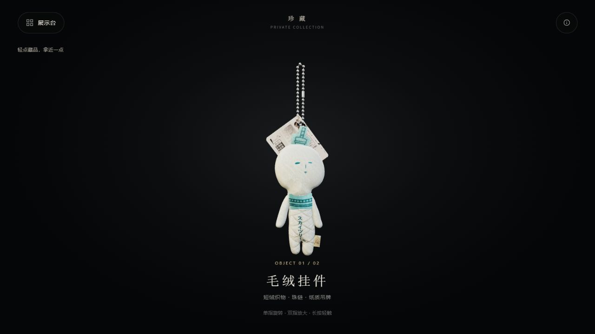

# 珍藏 · 私人藏品

毛绒挂件与晴空塔冰箱贴的悬浮交互展览。下载本分支后，打开 [离线完整展览](dist/keepsake.html) 即可使用，模型、贴图和程序已全部内嵌。

## 本次更新

去掉桌面、柜体和台灯，改为黑暗环境中的单件悬浮陈列。柔和主光、冷色补光和轮廓光呈现短绒、珠链、纸卡与金属边缘。左上角「展示台」打开两件藏品的真实模型预览，点选即可切换。

手机轻点物件拿近，单指旋转，双指缩放与转动，长按轻触。拿近时底部说明自动隐去；全部按钮保留在顶部，触控区至少 44 像素。玩偶的按压只产生不超过 0.45 mm 的微小压痕，松手恢复；悬浮模式不运行落桌或重力抛掷。

冰箱贴拿近后轻点，按封口、纸卡、吸塑壳、本体的正常顺序逐步打开。空包装自动退场，当前物品平滑居中。已取出的卡片与冰箱贴可轻微弯曲并恢复，详情中可装回原包装。

保留照片还原的不对称薄头、细腿、正面布饰与缝入身体的布标，毛绒照片图集为 3072×3072，主体 162,708 个三角形。离线图片无损内嵌，显示像素比例最高为 3。

[手机展示](preview/exhibition-mobile.jpg) · [物品预览](preview/exhibition-gallery.jpg) · [拿近细看](preview/exhibition-detail.jpg) · [冰箱贴](preview/exhibition-magnet.jpg)

## 独立模型

- [毛绒本体](models/plush-body.glb)
- [毛绒与珠链吊牌](models/plush-chain-tag.glb)
- [冰箱贴本体](models/magnet.glb)
- [冰箱贴与完整包装](models/magnet-packaged.glb)

四份含内嵌贴图的 GLB 保留之前的照片重建几何，单位为米；静态模型不含网页交互。网页详情菜单还可下载当前模型。[使用说明](使用说明.txt) 包含触摸、拆包和电脑操作。

## 构建与验证

安装 Node.js、Python，运行 `npm ci`、`pip install Pillow`、`python tools/build.py`。开发时 `python tools/devserver.py 8877`，访问 `http://127.0.0.1:8877/index.html`。

当前验收入口是 `dev/exhibit-check.html`；参数 `?offline`、`?offline&desktop` 分别验证最终离线手机版与桌面版。另起 `python dev/qa-server.py` 保存报告。本轮手机与桌面各 42 项离线检查通过，包含三个手机横竖尺寸、手势接续、微小形变复原、静止稳定和五步拆包；离线页拒绝 HTTP/HTTPS 资源，报告带源文件和交付 HTML 的 SHA-256。

新下载导出的两件模型已校验并用 GLTFLoader 重新读回。四份原有独立 GLB 重新校验。`npm test` 的 38 项基础模型与原物理引擎检查通过；该原引擎的落桌测试不代表当前悬浮模式提供落桌功能。

[最新手机验证](verification/exhibit-offline-mobile.json) · [桌面验证](verification/exhibit-offline-desktop.json) · [下载读回](verification/exhibit-readback-report.json) · [验证说明](验证记录.txt)

旧 `dev/check.html` 和 `offline-check.html` 及旧报告保留为桌面场景历史记录，不用于当前展览验收。当前源文件摘要见 [source-hashes.json](verification/source-hashes.json)。

尺寸和材料响应为照片估算，手机触摸采用浏览器模拟，未逐台实测手机硬件。原始照片、身份证影像、私人下载链接与本机备份未随仓库发布。
