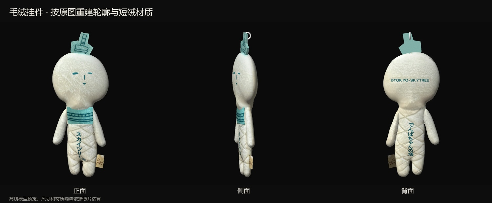

# 珍藏小物 · 照片重建收藏

毛绒挂件与晴空塔冰箱贴的离线交互收藏。下载此分支后，打开 [完整交互版](dist/keepsake.html) 即可使用；HTML 内含所需模型、贴图和程序。

## 本次修订

重新查看原始正面、背面、侧面及细节照片后，重建不对称头部、较扁的身体及自然收窄的双腿；去掉粗圆脚、过厚的填充轮廓和突出的颈部。布标根部埋入右侧接缝，跟随身体受力。

正反面保留照片中的短绒、五官、印字与交叉缝线，降低法线凹凸强度。胸前布饰只覆盖正面。交互改为较实的填充物：局部位移不超过约 2 mm，压缩很小、阻尼较高，松手后稳定恢复；挂链摆动、直接抓取和落桌碰撞仍可使用。

## 独立模型

- [毛绒本体](models/plush-body.glb)
- [毛绒及珠链吊牌](models/plush-chain-tag.glb)
- [冰箱贴本体](models/magnet.glb)
- [冰箱贴及完整包装](models/magnet-packaged.glb)

均为含内嵌贴图的 GLB，单位为米。静态模型保存形状与外观；互动保存在 HTML 中。[使用说明](使用说明.txt) 包含手势、正常拆包和台灯操作。

## 构建与验证

安装 Node.js 22+ 和 Python 后运行 `npm ci`、`pip install Pillow`、`npm run build`。开发入口为工程目录的 `index.html`，需用 `python tools/devserver.py 8875` 通过本机 HTTP 打开。

`npm test` 运行模型、布标连接、单指抓取、双指受限变形、取下、落桌、GLB 导出与读回检查。验证记录位于 [verification/model-physics.json](verification/model-physics.json)。离线渲染预览可通过安装 `requirements.txt` 的依赖后运行 `python tools/render_plush_review.py` 重建。

本轮 27 项模型与物理检查通过，四份交付 GLB 的几何和内嵌贴图检查通过。浏览器检查工具连接失败，本轮实时 WebGL 效果及手机触摸路由尚未重新验证；预览图为离线模型渲染。[验证记录](验证记录.txt) 说明验证范围。

尺寸和材料响应为照片估算，不等同于精密扫描或实物材料测量。原始照片、身份证影像、私人下载链接和本机备份未随仓库发布。模型重建脚本需要的原图由收藏者在本机另行保存。
